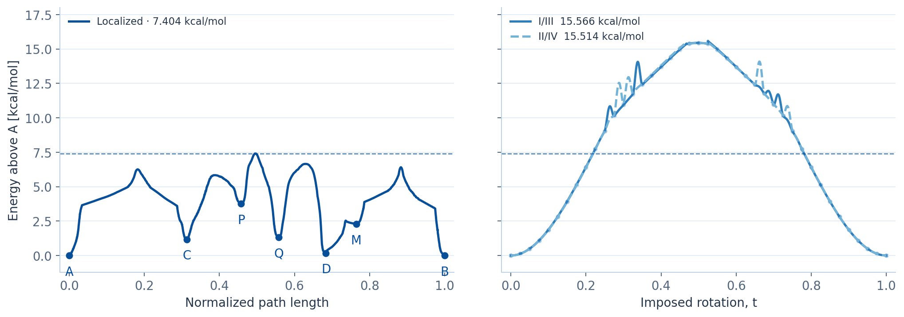
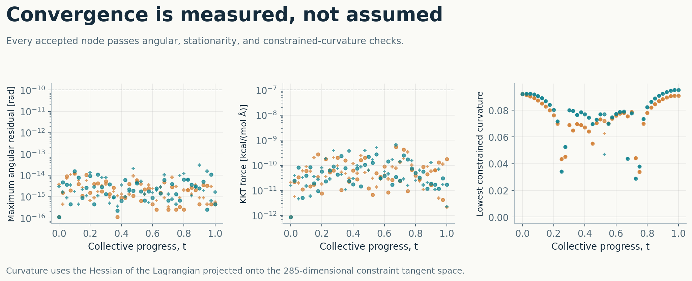

Files from a molecular geometry example for the AI in Life Sciences course (IOAI 2027).

The animation follows the localized path from A to B.

Energy along the localized path on the left and the two synchronized paths on the right. The x-axis shows path length on the left and imposed rotation on the right.

Checks on the optimized structures: angle constraints, residual forces and curvature.

Each row is one step along the path. Darker cells show which adjacent ring pair contributes more to the motion near the saddle. Percentages are relative within each row. The D → M step mainly rearranges a methyl group, with little ring motion.

Each point is a conformation and each line is a connection. The dark blue route is the one shown in the animation. The positions of the points are only for display.

[Running the scripts](docs/reproduction.md) · [Interactive view](docs/explorer.html)
