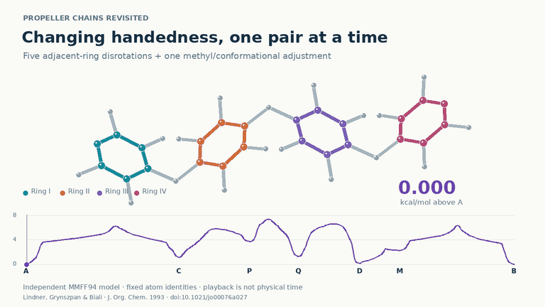
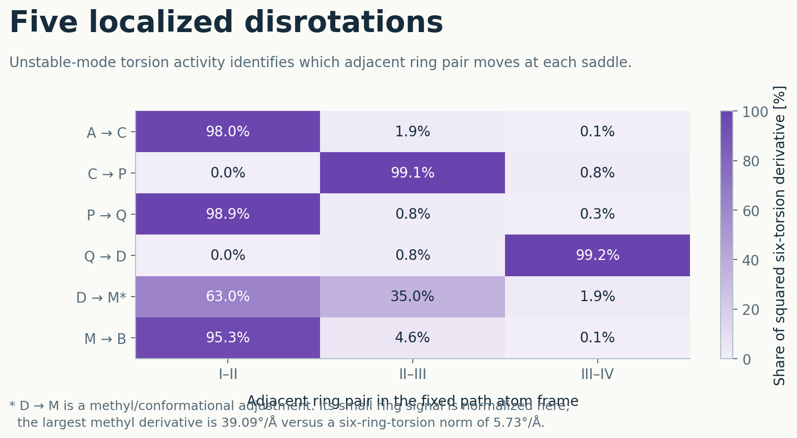
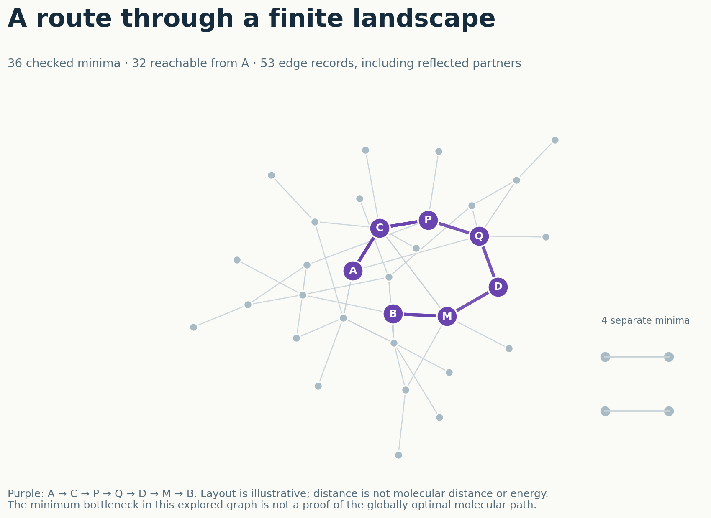

# Propeller Chains Revisited

**A teaching case in chemical geometry for generative models**

This is one small example in an **AI in Life Sciences** course being designed for the **National Olympiad on Artificial Intelligence committee**. Its intended audience is students preparing for **IOAI 2027**. The teaching question is: **what must a generative model respect when it proposes a molecular structure or motion?**

The current project supplies classical **MMFF94** calculations, recorded paths, and a validation workflow that a future generative method can be tested against. No generative model has been trained or evaluated in this project. Start with the [course case study and exercises](docs/course_case_study.md).

This project revisits compound **6** in Ariel B. Lindner, Flavio Grynszpan, and Silvio E. Biali's 1993 paper, [*Transmission of Internal Rotations: Correlated, Uncorrelated, and Localized Disrotatory Rotations in Propeller Chains*](https://doi.org/10.1021/jo00076a027). It asks how a succession of local ring motions compares with two explicitly defined synchronized motions.

The example also has a personal connection: revisiting my supervisor Ariel B. Lindner's first paper through an inspectable computational experiment. Credit for the original mechanism belongs to all three paper authors. This project supplies a separate **MMFF94** model, numerical checks, new figures, and code. The paper used **MM2**.



*The animation follows recorded heavy-atom configurations with fixed identities. Its speed is chosen for visibility; it is not a molecular dynamics trajectory or a physical time scale. [MP4](figures/localized_motion.mp4) · [Offline interactive explorer](docs/explorer.html)*

## The result

The localized route connects the enantiomeric endpoint minima through

**A → C → P → Q → D → M → B**.

It contains **five neighboring-ring disrotations and one methyl/conformational adjustment**. Six independently checked index-one saddles connect the required minima. The highest energy is **7.403995 kcal/mol above A**.

The new synchronized comparison uses converged constrained-minimum branches and explicit physical connectors where those branches change conformation. Both complete candidates connect the same physical A/B enantiomers with the same force field and energy reference.

| Explicit candidate | Highest numerically checked energy above A | What was checked |
|---|---:|---|
| Localized A → C → P → Q → D → M → B | **7.403995 kcal/mol** | Six saddles, both downhill endpoints, joins, and recorded gaps |
| Synchronized I/III | **15.565904 kcal/mol** | Fixed-progress branches, constrained connectors, endpoints, and recorded gaps |
| Synchronized II/IV | **15.514201 kcal/mol** | Fixed-progress branches, constrained connectors, endpoints, and recorded gaps |

These are **potential-energy heights of explicit candidate paths**. The localized route is lower than the two synchronized candidates tested here. This does not establish that every collective route is higher or that the localized route is globally optimal.

The [machine-readable comparison](results/summary.json) records the full values and provenance. Both synchronized datasets passed separate numerical audits: [I/III](results/reference/collective/I_III/independent_audit.json) and [II/IV](results/reference/collective/II_IV/independent_audit.json).


The x coordinates have different meanings: normalized recorded path length for the localized route, and prescribed six-torsion progress for the synchronized candidates. The energy reference is identical: **E(A) = 204.51121410431 kcal/mol**.

## The useful surprise: converged points do not automatically make a path

The earlier stiff-penalty calculations produced continuous candidates around 16 kcal/mol, but their inner optimizers stopped before convergence. Replacing penalties with six exact angular equalities solved that numerical conditioning problem.

That exposed a second problem. Forward and reverse optimization can reach different constrained conformations at the same progress. Joining their energies into a smooth-looking plot can hide a geometric jump and an additional barrier. In the first coarse I/III sequence, direct Cartesian connectors overshot the optimized-node energies substantially.

We retained those branches, followed the central minima with a local KKT predictor/corrector, and located **index-one saddles on the fixed-progress constraint surface**. Feasible, energy-decreasing trajectories on both sides checked which constrained minima each saddle connects. Those connectors are included in the complete candidates and in their reported maximum energies.

These fixed-progress saddles are not ordinary unrestricted molecular transition states. They supply the connections used in the selected constrained construction. The peripheral connecting segments are explicitly projected and checked; they are not all constrained energy minima.


## Reproduce from a checkout

Use Python 3.12 for the recorded reference environment. From the repository root:

```bash
python3.12 -m venv .venv
source .venv/bin/activate
python -m pip install -r requirements-reproduce.txt
python -m pip install --no-deps -e .
python -m propeller_paths verify
```

Then repeat the selected localized route:

```bash
python -m propeller_paths sequential
```

Repeat both exact-constraint forward/reverse node studies:

```bash
python -m propeller_paths collective
```

Repeat the complete synchronized candidates, including their fixed-progress connectors:

```bash
python -m propeller_paths paths
```

Every command creates a fresh directory under `runs/`. Existing output directories are rejected. Actual force, constraint, curvature, and endpoint checks decide acceptance; optimizer success messages alone do not.

`collective` produces independent **node sequences**, so its node maxima must not be substituted for the complete path maxima produced by `paths`. The quick `verify` command checks model consistency and the saved stationary seeds; it does not repeat a path search. Detailed command scopes and timing observations are in [reproduction.md](docs/reproduction.md).

To regenerate the original figures and explorer:

```bash
python -m pip install -e '.[figures]'
python tools/build_figures.py
python tools/build_explorer.py
```

`tools/build_motion.py` additionally requires FFmpeg and a DejaVu Sans font; the ready-to-use MP4 and GIF are included. No GPU is required.

## The localized events



The five ring events concentrate approximately **95–99%** of their squared six-torsion derivative in one adjacent ring pair, with the two local derivatives having opposite signs. The D → M step changes methyl/conformational organization without a main pair-helicity reversal. The classification follows the actual stationary geometry and unstable mode, not merely the direction used to generate a seed.

P and Q are display names for archived minima `N002` and `N015`; D remains the D of the original central calculation. Computational labels are not assumed to coincide with the paper's barred and unbarred letters.

## The finite explored landscape



The checked, reflection-closed graph contains **36 minima**, **32 reachable from A**, and examples of all **20 coarse form/sign classes** in the present classification. Its **53 edge records include 26 checked reflected partners** and parallel records. They are not 53 independent discoveries.

The 7.403995 kcal/mol bottleneck is the best found in that finite graph. Coarse-form coverage does not enumerate every methyl rotamer, microscopic minimum, or molecular path. The selected-route command repeats its six connections; it does not rerun the entire historical exploratory search.

## How this relates to the 1993 paper

For compound 6, the paper describes a localized MM2 graph route with a 4.3 kcal/mol bottleneck and an ideal collective comparison at 10 kcal/mol. Its collective estimates used torsion-frozen constructions. Our force field, geometric construction, refinements, and path checks differ, so this project tests the mechanistic idea rather than reproducing those numbers.

**The paper's separate experimental 7.4 kcal/mol upper bound concerns compound 5.** Its proximity to our compound-6 MMFF94 value of 7.403995 is a numerical coincidence, not experimental validation.

Our results support a complete localized mechanism in this explicit MMFF94 model and show that it lies below the two specified synchronized candidates. Thermal free energies, rates, solvent effects, force-field accuracy, and global optimality remain outside the established result.

## A benchmark for geometric path proposals

A future angular, manifold, or learned proposal method can be tested against concrete criteria: preserve molecular geometry; respect graph symmetry while keeping enantiomers distinct; connect the intended minima; find or refine the correct stationary index; and account for energy between saved configurations. Short Cartesian distance and an attractive animation are insufficient.

This repository does not train a neural model or demonstrate an advantage of diffusion models. It provides explicit reference paths and failure cases against which such methods could be evaluated.

## Citation and credit

Ariel B. Lindner, Flavio Grynszpan, and Silvio E. Biali. “Transmission of Internal Rotations: Correlated, Uncorrelated, and Localized Disrotatory Rotations in Propeller Chains.” *The Journal of Organic Chemistry* **58**(24), 6662–6670 (1993). [doi:10.1021/jo00076a027](https://doi.org/10.1021/jo00076a027).

See [CITATION.cff](CITATION.cff), [references.bib](references.bib), and [ACKNOWLEDGMENTS.md](ACKNOWLEDGMENTS.md). The new implementation was prepared with AI-assisted coding and explicit numerical validation. The historical authors are not implied to have reviewed or endorsed this code. Original figures are generated from the new data; the publisher's PDF is not redistributed.
